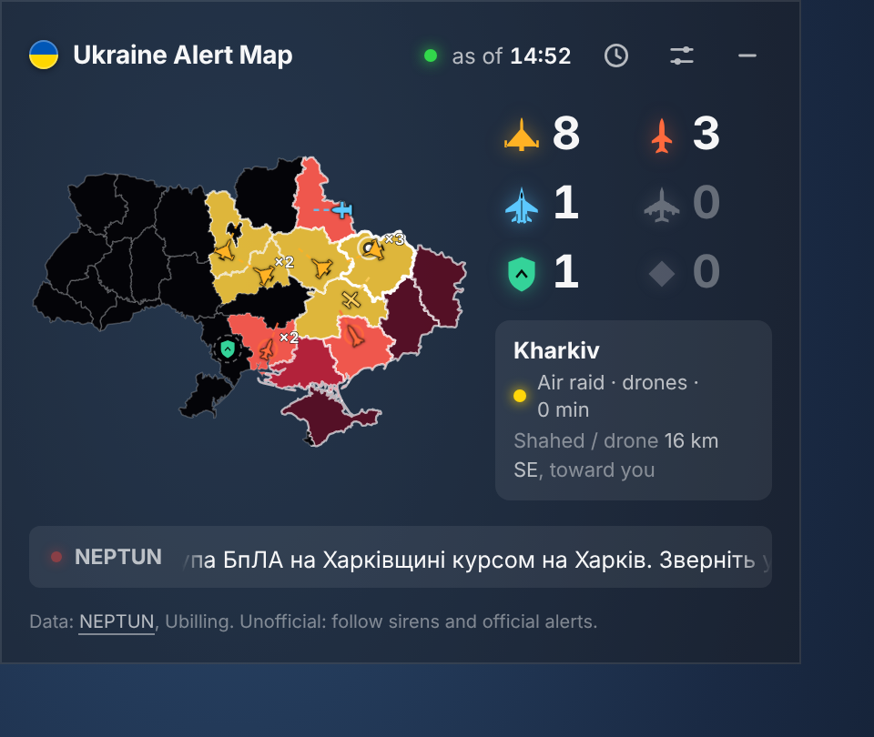

# Ukraine Alert Map для Windows 11

Віджет для робочого столу Windows 11: повітряні тривоги в Україні по областях і районах, повітряні цілі за координатами й курсом, стрічка повідомлень, історія та сповіщення, коли тривога або ціль наближається до вашого міста. Окремий застосунок із інсталятором: нічого стороннього ставити не потрібно.

*English: a standalone Windows 11 desktop widget (Electron) that shows live air-raid alerts and air targets in Ukraine, with a news-style ticker, history, and toast notifications. No API keys, no extra software. Unofficial: always follow official sirens.*



> Скриншоти зроблені на **тестових даних** (не реальна ситуація). Розмиття Acrylic на них лише імітується напівпрозорою заливкою.

> ⚠️ **Це неофіційне джерело.** Дані надходять від сторонніх сервісів, можуть запізнюватися або містити помилки. Застосунок **не замінює** сирени та офіційні оповіщення («Повітряна тривога», ДСНС, військові адміністрації).

## Можливості

- **Оформлення Windows 11 (Fluent):** фон Acrylic або Mica, шрифт Segoe UI Variable, акцентний колір вашої системи, темна/світла/авто тема.
- **Карта областей і районів:** 🟡 жовтий — лише БпЛА, 🔴 червоний — ракети (крилаті, балістика), КАБ, стратегічна авіація або тривога без відомих цілей. Чим довше триває загроза, тим темніший колір.
- **Цілі з силуетами:** шахед, розвідувальний БпЛА, крилата й балістична ракети, КАБ, тактична та стратегічна авіація. Силует повернутий за курсом, є лінія курсу й слід.
- **Живе оновлення:** WebSocket-потік NEPTUN (зміни з'являються миттєво); якщо він недоступний, опитування кожні 6 с.
- **Стрічка повідомлень** з Telegram-каналів (можна вимкнути) та **історія** цілей, тривог і повідомлень.
- **«Моє місто»:** статус району/області, найближча ціль, відстань і напрямок.
- **Сповіщення Windows і звук:** початок тривоги, відбій, цілі в обраному радіусі, ціль у вашому районі. Сирену й сигнал наближення застосунок генерує сам.
- **Значок у треї**, запуск разом із Windows, режим «поверх усіх вікон», запам'ятовування положення.
- **Без ключів і реєстрацій.** Усі джерела безкоштовні й відкриті.

## Встановлення

Потрібно: Windows 11 (для Acrylic/Mica бажано 22H2 і новіше). Підтримка інших версій Windows планується з подальшими оновленнями.

1. Завантажте `Ukraine-Alert-Map-Setup-<версія>.exe` зі сторінки [Releases](../../releases).
2. Запустіть інсталятор (права адміністратора не потрібні, встановлення для поточного користувача).
3. Windows SmartScreen може показати «Windows protected your PC». Інсталятор поки **не підписаний** сертифікатом (це платно), тому натисніть **More info → Run anyway**. Якщо не довіряєте готовому файлу, зберіть його самі (див. нижче).
4. Віджет з'явиться в правому верхньому куті екрана, а значок у треї дозволить ним керувати. **Автозапуск з Windows увімкнено при першому запуску**, вимкнути його можна в меню трея.

## Керування

- **Перетягувати** віджет можна за будь-яке місце картки. Положення запам'ятовується; якщо монітор відключили, віджет повертається в кут екрана.
- Кнопки в шапці: 🕒 історія, ⚙︎ налаштування, − сховати в трей. Клік по стрічці теж відкриває історію.
- **Меню трея** (клік правою кнопкою): показати/сховати, поверх усіх вікон, запуск з Windows, фон (Acrylic / Mica / суцільний), відкрити `config.json`, скинути положення, вийти.
- Закриття вікна лише ховає віджет у трей; застосунок закривається пунктом «Вийти».

## Налаштування

Панель налаштувань відкривається кнопкою ⚙︎ у віджеті. Зміни зберігаються автоматично, **Reset** (Data) повертає значення за замовчуванням.

**Display:** мова (English / Українська; за замовчуванням за мовою системи), тема, палітра, режим кольорів (за типом загрози / завжди червоні), «найтемніший через» (1/3/6/12 год), фільтр цілей, розмір (80–140 %), райони, штриховка, курс і сліди, стрічка та її швидкість, режим «лише лічильники».

**Data:** джерело тривог (Auto: NEPTUN, а якщо мовчить, то Ubilling / NEPTUN / Ubilling / Klymenko / JAAM), мінімальна достовірність, термін історії (6/24/72 год), живий потік, «спостереження», застарілі треки, стан джерел.

**Notify:** сповіщення, звук і його тип (Siren / System), «Моя область» і «Моє місто» (~75 міст), початок тривоги, відбій, цілі поблизу, радіус (25/50/100/150 км), кнопки перевірки сповіщення, сирени й сигналу наближення.

### Файл `config.json` (необов'язково)

Для того, чого немає в панелі, створіть (або відкрийте через меню трея) файл `config.json` у теці даних застосунку, зазвичай `%APPDATA%\Ukraine Alert Map\`. Значення з нього перекривають значення за замовчуванням, а невідомі ключі й значення не того типу ігноруються. Приклад:

```json
{
  "soundUrlAlert": "file:///C:/Sounds/siren.wav",
  "soundUrlNear": "https://example.org/beep.mp3",
  "extrapolateMaxSec": 300,
  "lang": "uk"
}
```

Доступні ключі: усі параметри блоку `config` у `src/widget.js` (`lang`, `appearance`, `palette`, `nRadius`, …), а також `soundUrlAlert`, `soundUrlNear`, `extrapolateMaxSec`, `staleAfterSec`, `offlineAfterSec`. Налаштування з панелі мають пріоритет над `config.json`. Використовуйте лише звуки, на які у вас є права. Після зміни файлу перезапустіть застосунок.

## Сповіщення і звук

- Сповіщення з'являються як звичайні toast-повідомлення Windows від «Ukraine Alert Map». Перевірити їх можна кнопкою *Send test* (Notify). Якщо їх немає: Параметри Windows → Система → Сповіщення → Ukraine Alert Map.
- **Режим «Фокусування» / «Не турбувати» може приховувати toast-и.** Додайте Ukraine Alert Map до пріоритетних застосунків. Звук застосунок відтворює сам, тож він лунає й коли toast приховано (вимикається перемикачем *Sound*).
- У віджеті на ~25 с з'являється червоний банер (клік закриває його).
- **Що сповіщає:** початок тривоги або загрози у вашій області/районі, відбій (після ≥ 15 с без тривоги), ціль у радіусі навколо міста й ціль у вашому районі.
- **Наближення:** спрацьовує, коли ціль у радіусі **і** летить у ваш бік (курс у межах ±70° або відстань зменшується). Для балістики радіус ×3, для крилатих ракет ×2. Є два рівні: у межах радіуса та ближче ніж 1/3 радіуса.
- **Звук:** сирена (4 с) — для тривоги, ракет і дуже близьких цілей; короткий сигнал — для першого наближення дрона. Тип *System* відтворює файли з `C:\Windows\Media` (`Alarm05.wav`, `Windows Notify System Generic.wav`).

## Джерела даних і приватність

| Джерело | Що дає | Примітка |
|---|---|---|
| [NEPTUN](https://neptun.in.ua/developers) | Цілі (координати, курс, швидкість, тип), тривоги по районах/областях, повідомлення з Telegram, межі районів | REST + WebSocket, без ключа. **За умовами NEPTUN у віджеті є видиме посилання на сервіс.** |
| [Ubilling](https://wiki.ubilling.net.ua/doku.php?id=aerialalertsapi) | Тривоги по областях (запасне джерело; також Klymenko та JAAM) | Без ключа |

**Приватність:** немає аналітики й облікових записів. Усі мережеві запити виконує лише головний процес і лише до `neptun.in.ua` та `ubilling.net.ua`; сторінка інтерфейсу взагалі не має доступу до мережі (політика CSP `connect-src 'none'`). Ваша область і місто зберігаються локально, відстань до цілей рахується на вашому комп'ютері.

Дані зберігаються в `%APPDATA%\Ukraine Alert Map\`: налаштування й історія (Local Storage), `window.json` (положення), `cache\raions.geojson` (межі районів, оновлюються раз на тиждень), `config.json`.

## Як це влаштовано

```
main.js        Головний процес: вікно (Acrylic/Mica), трей, сповіщення, автозапуск, IPC
preload.js     Вузький міст між інтерфейсом і головним процесом (contextIsolation, sandbox)
src/service.js Мережа: опитування, WebSocket з автоперепідключенням, кеш меж районів
src/widget.js  Інтерфейс: карта, цілі, лічильники, стрічка, історія, налаштування
src/index.html, src/boot.js   Оболонка сторінки (суворий CSP)
test/          Тести service.js і main.js
```

Безпека: рендерер працює в `sandbox` без Node, з `contextIsolation`; відкрити зовнішнє посилання або зробити запит можна лише до дозволених хостів по HTTPS; навігація й `window.open` заблоковані; усі тексти з API екрануються перед виведенням.


## Стан тестування та відомі обмеження

 Після першої збірки можливі виправлення; знайшли помилку, створіть Issue.

- Фон Acrylic не тонується й може виглядати плоскішим, коли вікно неактивне. Якщо вигляд не подобається, оберіть Mica або «Суцільний» у меню трея.
- Колір за типом загрози обчислюється для області, а не для кожного району окремо.
- Рівня «жовта загроза» як окремого офіційного статусу немає: жовтий тут означає «лише дрони».
- Роботу ППО (зелений щит) розпізнано евристично з текстів повідомлень.
- Інсталятор не підписаний, тому SmartScreen попереджає.
- На даний момент підтримується лише Windows 11

## Усунення несправностей

| Проблема | Що робити |
|---|---|
| Віджета не видно | Перевірте значок у треї (він може бути в прихованих значках `^`) → «Показати»; або «Скинути положення» |
| Немає сповіщень | Параметри Windows → Система → Сповіщення → Ukraine Alert Map; перевірте режим «Фокусування» |
| Немає звуку | Перевірте гучність і перемикач *Sound*; натисніть *Test siren* |
| «Data unavailable» | Немає інтернету або сервіси недоступні; Data → стан джерел |
| «stream: reconnecting» | Потік недоступний, застосунок працює на опитуванні (6 с); це нормально |
| Районів немає («districts: …») | Межі завантажуються у фоні при першому запуску; зачекайте хвилину. Тим часом область штрихується |
| Фон вікна плоский або чорний | Меню трея → Фон → Mica або «Суцільний» |
| Скинути налаштування | Data → **Reset**; для повного скидання видаліть `%APPDATA%\Ukraine Alert Map\` |

## Видалення

«Параметри Windows → Застосунки → Ukraine Alert Map → Видалити». Дані користувача лишаються в `%APPDATA%\Ukraine Alert Map\`, видаліть цю теку вручну, якщо потрібно.

## Походження, подяки та ліцензія

- Проєкт починався як доопрацювання віджета **[dr-mod/air-raid-widget-macos](https://github.com/dr-mod/air-raid-widget-macos)** (MIT, © 2022 Dmytro Panin). Код цієї версії переписано; від вихідної версії лишилися ідея та контури областей.
- Дані: [NEPTUN](https://neptun.in.ua/), [Ubilling](https://wiki.ubilling.net.ua/doku.php?id=aerialalertsapi).
- Платформа: [Electron](https://www.electronjs.org/), [electron-builder](https://www.electron.build/).

Ліцензія: [MIT](LICENSE). Збережено сповіщення про авторські права оригінального проєкту.
